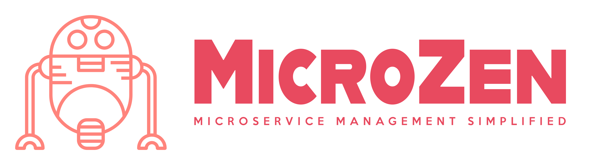

# About MicroZen

Introducing **MicroZen**, a revolutionary Microservice Management tool designed to streamline the complexities of modern software architectures.

With an intuitive graphical user interface (GUI) and simplicity at its core, MicroZen empowers developers and architects to effortlessly catalogue microservices and micro-frontend applications, offering unparalleled visibility and control over the intricacies of their systems.

From health checks to comprehensive mapping of application and API interactions, MicroZen provides a centralized platform for orchestrating seamless authentication, service mapping, and uptime observability within distributed architectures.

## Main Features Include:

- **Graphical User Interface (GUI)**: Intuitive interface for easy cataloguing of microservices and micro-frontend apps.
- **Application and API Mapping**: Visualize and manage interactions between different apps and APIs.
- **Health Checks Tracking**: Monitor the health and performance of microservices in real-time.
- **OAuth2/OpenID Connect Support**: Support for secure authentication processes, managing client IDs and secrets for multiple OAuth2 flows.
- **Comprehensive Security**: Ensure data integrity and confidentiality with robust authentication mechanisms and secure AES-512 encrypting of sensitive data.
- **Scalability**: Accommodate the growth and complexity of microservice architectures with ease.
- **Centralized Management**: Simplify the management of microservices through a centralized platform.
- **Efficient Workflow**: Streamline development workflows and enhance productivity with seamless integration.

# QuickStart Guide

MicroZen is an Nx monorepo that contains an Angular/Ionic front-end and a .NET (C#) back-end. Follow the steps below to get a local environment running.

## Prerequisites

- [Node.js](https://nodejs.org/en/download/)
- [.NET 10 SDK](https://dotnet.microsoft.com/download/dotnet/10.0) (the solution targets `net10.0`)
- [Docker](https://docs.docker.com/get-docker/) (used to run the PostgreSQL database)

## 1. Clone the repository

```bash
git clone https://github.com/MicroZenHub/MicroZen.git
cd MicroZen
```

## 2. Install dependencies

Install the JavaScript dependencies from the repository root. The `npm ci` command runs the `prepare` script, which in turn triggers the `@nx-dotnet` restore:

```bash
npm ci
```

Restore the .NET dependencies:

```bash
dotnet restore core/csharp/MicroZen.Core.sln
```

## 3. Start the database

The API needs a PostgreSQL database named `MicroZenDb`. A `docker-compose.yml` at the repository root runs a pinned PostgreSQL image with a named volume and a healthcheck. First copy the example environment file and adjust the placeholder values, then start the database:

```bash
cp .env.example .env
docker compose up -d
```

`.env` is gitignored, so your local credentials are never committed. The `.env` file documents every variable the stack needs: the `POSTGRES_*` values consumed by Compose, the `ConnectionStrings__MicroZenDb` connection string the API uses (the connection string name is `MicroZenDb`), and the `MicroZen__*` OAuth2/Cognito settings read by `AddMicroZenOAuth2` in `Program.cs`.

On startup the API applies the Entity Framework migrations and seeds development data automatically, so you only need the database running and reachable through the `MicroZenConnectionString` connection string. Make sure the API process sees the same configuration. `docker compose up -d` only substitutes `.env` into the Compose file's own variable interpolation; it does not export those variables to a later `dotnet run`. Supply them to the API process in one of the following ways: export the variables from your `.env` into the environment (for example `export $(grep -v '^#' .env | xargs)`), store them with `dotnet user-secrets`, or put them in an `appsettings.Development.json`.

### Seeding development data

On startup the API can seed a usable set of placeholder data (one Organization, a Client, an OAuth2 client-credentials row, and an API key) via `app.MigrateAndSeedDevDataOnStart()` in `core/csharp/MicroZen.Api/Context/Functions.cs`. Seeding runs only when all of the following are true:

- the environment is `Development` (`ASPNETCORE_ENVIRONMENT=Development`),
- the `SeedDevData` configuration flag is `true`, and
- the `Organizations` table is empty (so seeding is idempotent and safe to leave on).

The `launchSettings.json` `http`/`https` profiles already set `ASPNETCORE_ENVIRONMENT=Development`, so you only need to enable the flag. Any of these work:

- Run with the environment variable set: `SeedDevData=true dotnet run --project core/csharp/MicroZen.Api`
- Add `"SeedDevData": true` to an `appsettings.Development.json`
- Add `SeedDevData=true` to your `.env` (see `.env.example`) and export it to the API process

Because of the empty-table guard, **re-seeding requires an empty database**. Reset the Compose PostgreSQL by dropping its named volume and starting fresh, then run the API with seeding enabled:

```bash
docker compose down -v   # drops the microzen-pgdata volume
docker compose up -d     # recreates an empty MicroZenDb
SeedDevData=true dotnet run --project core/csharp/MicroZen.Api
```

The helper script `scripts/seed-db.sh` wraps this. It runs the API with `ASPNETCORE_ENVIRONMENT=Development` and `SeedDevData=true`, and `--reset` first recreates the Compose database so the data is seeded fresh:

```bash
./scripts/seed-db.sh           # seed against the current database
./scripts/seed-db.sh --reset   # reset the Compose DB, then seed
```

All seeded values are placeholders; no real secrets are involved. For the full list of seeded fields, see [.kiro/steering/tech.md](.kiro/steering/tech.md).

## 4. Run the applications

Run the front-end (Angular/Ionic dashboard):

```bash
npx nx serve core-dashboard
```

Run the back-end API:

```bash
dotnet run --project core/csharp/MicroZen.Api
```

The API listens on http://localhost:5187 and https://localhost:7070 (per `launchSettings.json`).

## 5. Build

```bash
# Front-end
npx nx build core-dashboard

# Back-end
dotnet build core/csharp/MicroZen.Core.sln
```

## 6. Test

```bash
# Front-end
npx nx test core-dashboard

# Back-end
dotnet test core/csharp/MicroZen.Core.sln
```

# Contributing

Contributions are welcome. MicroZen is licensed under the Apache-2.0 license (see [LICENSE](LICENSE)).

## Workflow

1. Create a branch from `main`.
2. Make your changes and commit them.
3. Open a pull request against `main`.

Continuous integration runs on every pull request and on every push to `main` (see [.github/workflows/ci.yml](.github/workflows/ci.yml)).

## Local checks before opening a PR

Run the same gate that CI runs so your pull request passes on the first try:

```bash
# Verify formatting (fix with: npx nx format:write)
npx nx format:check

# Lint, test, and build the affected projects
npx nx affected -t lint test build

# Run the .NET tests
dotnet test core/csharp/MicroZen.Core.sln
```

## Conventions

- Code is formatted with [Prettier](https://prettier.io/) using single quotes (`singleQuote`), see `.prettierrc`.
- Editor settings (indentation, line endings, and so on) follow `.editorconfig`.

## Security note

The Nx Cloud access token that was previously committed to `nx.json` has been removed. Because it was exposed in the git history, a maintainer must rotate/revoke that token in Nx Cloud and store the replacement as the `NX_CLOUD_ACCESS_TOKEN` GitHub Actions secret used by CI.
