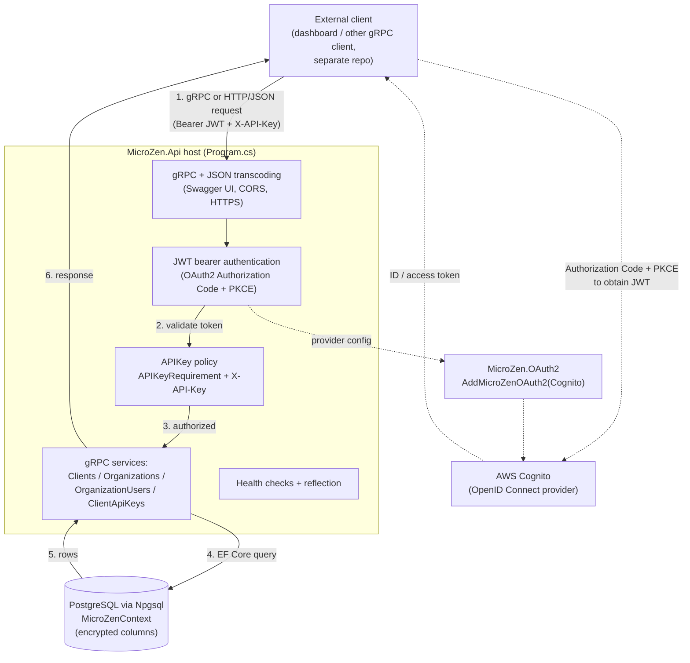

# MicroZen Architecture

This document maps the runtime architecture of the MicroZen backend so that a
change touching the API, auth, or the data layer can be reasoned about without
re-reading the whole codebase. It is intentionally concise: one request-flow
diagram plus short prose per layer.

> Scope: this repository is the **MicroZen backend** (API + OAuth2 library +
> data). The graphical dashboard (Angular 17 + Ionic/Capacitor) lives in a
> **separate private repository** and is deployed independently. It is an
> **external consumer** of this API and is described here only as such. Any
> other gRPC client (another service, a CLI) consumes the API the same way.

## Components

### External front-end (separate repo)

The MicroZen dashboard is a gRPC client hosted outside this repository. It talks
to `MicroZen.Api` the same way any other consumer does: either over native gRPC
or over HTTP/JSON through the API's gRPC-JSON transcoding, and it authenticates
with OAuth2 (Authorization Code + PKCE) plus an API key. Because it is external,
nothing in this repo builds, serves, or tests it.

### API: `MicroZen.Api`

`MicroZen.Api` is the gRPC service host. Everything below is wired in
`core/csharp/MicroZen.Api/Program.cs`:

- **gRPC with JSON transcoding and Swagger.** The host registers gRPC with JSON
  transcoding (`AddGrpc().AddJsonTranscoding()`), generates an OpenAPI document
  from the gRPC contracts (`AddGrpcSwagger()` + `AddSwaggerGen(...)`), and serves
  Swagger UI (`UseSwagger()` / `UseSwaggerUI(...)` at `/swagger/v1/swagger.json`).
  Transcoding means the same service methods are reachable both as native gRPC
  calls and as HTTP/JSON requests, which is how the external front-end and other
  JSON clients call the API.
- **gRPC services.** Four services are mapped:
  - `ClientsService` (`MapGrpcService<ClientsService>()`)
  - `OrganizationsService` (`MapGrpcService<OrganizationsService>()`)
  - `OrganizationUsersService` (`MapGrpcService<OrganizationUsersService>()`)
  - `ClientApiKeysService` (`MapGrpcService<ClientApiKeysService>()`)

  Each service derives from a generated gRPC base type (for example
  `ClientsService : Clients.ClientsBase`) and takes a `MicroZenContext` for data
  access. The `.proto` contracts live in `MicroZen.Api/Protos/`.

- **gRPC health checks and reflection.** The host registers and maps gRPC health
  checks (`AddGrpcHealthChecks()` + `MapGrpcHealthChecksService()`) and gRPC
  reflection (`AddGrpcReflection()` + `MapGrpcReflectionService()`).
- **CORS / HTTPS.** A permissive default CORS policy is added, HTTPS redirection
  is enabled, and HSTS is applied outside Development.

### Auth: `MicroZen.OAuth2` + API-key policy

Authentication and authorization are configured in `Program.cs` and implemented
in the reusable `MicroZen.OAuth2` library.

- **OAuth2 / OpenID Connect.** `Program.cs` calls
  `AddMicroZenOAuth2(MicroZenProvider.Cognito, policies, grantTypes: OAuth2GrantType.AuthorizationCodeWithPKCE)`.
  The `AddMicroZenOAuth2` extension (in `MicroZen.OAuth2/Initialization.cs`) wires
  the configured provider; for `MicroZenProvider.Cognito` it registers the AWS
  Cognito provider via `AddAWSCognitoMicroZenOAuth2(...)`. The selected grant type
  is **Authorization Code with PKCE**.
- **API-key authorization policy.** `Program.cs` defines an authorization policy
  keyed by `Constants.APIKeyAuthPolicy` (the string `"APIKey"`) that requires the
  **JWT bearer** authentication scheme (`JwtBearerDefaults.AuthenticationScheme`),
  requires an authenticated user, and adds an `APIKeyRequirement`
  (`MicroZen.Api/Security/APIKeys/Attribute/APIKeyRequirement.cs`). Callers supply
  their key in the `X-API-Key` header. So a request is authenticated by a JWT
  bearer token (issued through the OAuth2 flow) and additionally authorized by the
  API-key requirement.

### Data: EF Core + PostgreSQL

- **Context.** `MicroZenContext` (`MicroZen.Api/Context/MicroZenContext.cs`) is an
  EF Core `DbContext` registered against **PostgreSQL via Npgsql**
  (`options.UseNpgsql(...)` using the `MicroZenConnectionString` connection
  string). Its `DbSet`s are `Clients`, `ClientAPIKeys`, `OAuth2ClientCredentials`,
  `Organizations`, and `OrganizationUsers`.
- **Encryption.** Sensitive columns are encrypted at the model level
  (`modelBuilder.UseEncryption(...)` in `OnModelCreating`), so secrets such as
  OAuth2 client secrets are stored encrypted.
- **Migrations and dev seeding.** Migrations live in `MicroZen.Api/Migrations`. On
  startup `app.MigrateAndSeedDevDataOnStart()`
  (`MicroZen.Api/Context/Functions.cs`) applies any pending migrations and, in
  Development with `SeedDevData` enabled, seeds a sample `Organization` with a
  `Client`, an `OAuth2ClientCredentials` row, and a `ClientAPIKey` when the
  database is empty.

## Request flow

The diagram below shows a typical authorized request from the external front-end
(or any gRPC/JSON client) through the API, auth, and data layers.

Flow summary:

1. The client sends a gRPC or transcoded HTTP/JSON request carrying a JWT bearer
   token (obtained from the OAuth2 Authorization Code + PKCE flow against AWS
   Cognito) and an `X-API-Key` header.
2. The host authenticates the JWT bearer token.
3. The `APIKey` authorization policy enforces `APIKeyRequirement` before the call
   reaches a service.
4. The target gRPC service (`ClientsService`, `OrganizationsService`,
   `OrganizationUsersService`, or `ClientApiKeysService`) uses `MicroZenContext`
   to read or write PostgreSQL through Npgsql.
5. Rows come back from the data layer (sensitive columns decrypted by the EF Core
   encryption provider).
6. The service returns the response to the client as gRPC or JSON.

## Source map

| Concern                 | Where to look                                                      |
| ----------------------- | ------------------------------------------------------------------ |
| Host wiring             | `core/csharp/MicroZen.Api/Program.cs`                              |
| gRPC services           | `core/csharp/MicroZen.Api/Services/`                               |
| gRPC contracts          | `core/csharp/MicroZen.Api/Protos/`                                 |
| OAuth2 / OpenID Connect | `core/csharp/MicroZen.OAuth2/` (`Initialization.cs`, `Providers/`) |
| API-key auth            | `core/csharp/MicroZen.Api/Security/APIKeys/`                       |
| Data context            | `core/csharp/MicroZen.Api/Context/MicroZenContext.cs`              |
| Migrations / seeding    | `core/csharp/MicroZen.Api/Migrations/`, `Context/Functions.cs`     |
